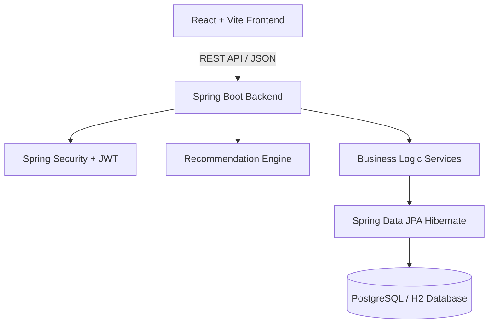

# TeamForge Architecture Documentation

## System Architecture

TeamForge is built using a modern, lightweight monorepo architecture:

## Core Modules

1. **Authentication & Authorization**: JWT token-based auth with BCrypt password hashing and role-based permissions (STUDENT, PROJECT_OWNER, ADMIN).
2. **Profile & Skill Management**: Dynamic skill taxonomy with proficiency levels, experience metrics, availability windows, and portfolio links.
3. **Project & Team Management**: Lifecycle tracking (IDEA, RECRUITING, IN_PROGRESS, COMPLETED, ARCHIVED), team roles, and member invitations.
4. **Intelligent Recommendation Engine**: Constraint-first multi-factor algorithm evaluating skill coverage, complementarity, role compatibility, availability, and team balance with explainability.
5. **Collaborative Task Manager**: Kanban task board with status tracking, priority flags, assignment, and task comments.
6. **Analytics & Research Evaluation**: Real-time team health indicators, skill demand distribution, and research evaluation metrics (Precision, Recall, F1-score).
